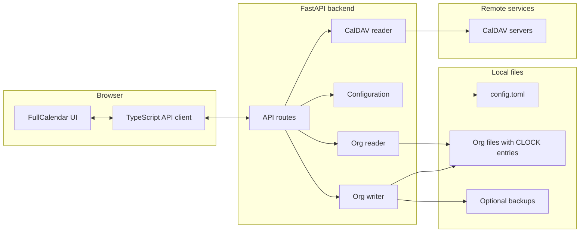

<div align="center">


# Stempelwerk

*Local-first calendar UI for Emacs Org mode clock entries.*

[](LICENSE)
[](pyproject.toml)
[](https://fastapi.tiangolo.com/)
[](https://www.docker.com/)
[](https://docs.astral.sh/uv/)
[](https://github.com/Embedded-Focus/stempelwerk/commits/main)

**[Architecture](#architecture)** ·
**[Development](#development)** ·
**[Demo](#demo)**

</div>

Local-first web application for viewing and editing Emacs Org mode
`CLOCK:` entries through an interactive calendar.

Org files remain the authoritative data store; the Python backend
exposes a local API and the frontend renders a FullCalendar-based
day/week view.

## Architecture



The browser talks only to the local API. The backend CalDAV reader fetches
read-only events from explicitly configured remote CalDAV servers; the browser
never contacts them directly.

## Development

```bash
uv sync
uv run uvicorn stempelwerk.app:create_app --factory --reload --host 127.0.0.1 --port 8765
```

Frontend development will run separately from `frontend/`:

```bash
npm install
npm run dev
```

Configure Org files in `config.toml`:

```toml
timezone = "Europe/Vienna"

[[files]]
id = "work"
path = "/home/user/org/work.org"
color = "#2563eb"

[[files]]
id = "customers"
path = "/home/user/org/customers.org"
color = "#16a34a"
```

Use another config file with:

```bash
STEMPELWERK_CONFIG=./config.local.toml make dev-api
```

The browser only receives configured file IDs. Calendar filtering uses repeated
`file_id` query parameters, for example
`/api/v1/clocks?...&file_id=work&file_id=customers`.

## CalDAV calendars (read-only)

Stempelwerk can display events from remote CalDAV calendars next to Org clock
entries. Each calendar is configured explicitly with a `[[caldav_calendars]]`
entry and an exact collection URL. There is no automatic discovery: copy the
collection URL from your CalDAV server.

You can configure any number of calendars. The backend reads credentials from
environment variables named in the configuration, so no credentials are stored
in `config.toml`. Multiple calendars can share the same username and password
environment variables.

```toml
caldav_timeout_seconds = 10
caldav_cache_seconds = 60

[[caldav_calendars]]
id = "team"
name = "Team calendar"
url = "https://caldav.example.com/dav/team/"
username_env = "STEMPELWERK_CALDAV_USERNAME"
password_env = "STEMPELWERK_CALDAV_PASSWORD"
color = "#d97706"

[[caldav_calendars]]
id = "holidays"
name = "Public holidays"
url = "https://caldav.example.com/dav/holidays/"
username_env = "STEMPELWERK_CALDAV_USERNAME"
password_env = "STEMPELWERK_CALDAV_PASSWORD"
color = "#7c3aed"
```

Set the environment variables before starting the backend:

```bash
export STEMPELWERK_CALDAV_USERNAME="your-username"
export STEMPELWERK_CALDAV_PASSWORD="your-password"
```

Behavior and limits:

- **Read-only.** CalDAV events cannot be created, edited, moved, or deleted.
  Double-clicking an event opens a details-only dialog. They also do not count
  in the work statistics, which are computed from Org clock entries only.
- **Visible fields.** The calendar shows the event title, its time, the
  calendar name, and the location when the server provides one.
- **Partial failure.** Calendars are fetched independently. If one server is
  unreachable, the remaining calendars still load and the status line shows a
  warning naming the unavailable calendars.
- **Cache and reload.** Responses are cached in memory for
  `caldav_cache_seconds` (default 60). Requests time out after
  `caldav_timeout_seconds` (default 10). Use the Reload button to bypass the
  cache and fetch fresh events.
- **TLS required.** URLs must use HTTPS and the server certificate must verify
  against the system trust store. OAuth and insecure or self-signed certificate
  bypass are not supported in this version.

## Demo

```bash
make demo-up
```

Then open `http://127.0.0.1:5173`.

Use `make demo-logs` to follow service output and `make demo-down` to stop the
environment.

The Compose demo defaults to Docker. To use Podman instead (requires the
`podman compose` plugin, e.g. `podman-compose` or `docker-compose`), run:

```bash
make demo-up CONTAINER_ENGINE=podman
```

The demo enables the debug panel, which offers a "Create backup" button per
configured file. Clock updates no longer create backups automatically; you
create them from this panel. The panel starts collapsed; click "Debug" to
expand it. In a dev setup you enable the panel with
`VITE_DEBUG_PANEL=1` in the environment of the dev server, or by opening the
frontend with `?debug=1` in the URL.
