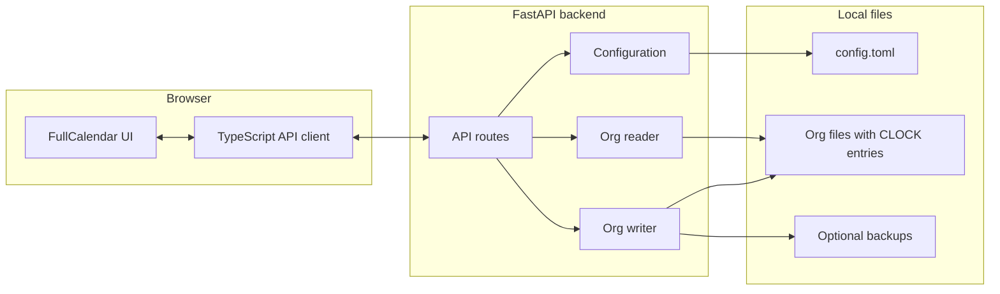

<div align="center">


# Stempelwerk

*Local-first calendar UI for Emacs Org mode clock entries.*

[](LICENSE)
[](pyproject.toml)
[](https://fastapi.tiangolo.com/)
[](https://www.docker.com/)
[](https://docs.astral.sh/uv/)
[](https://github.com/Embedded-Focus/stempelwerk/commits/main)

**[Architecture](#architecture)** ·
**[Development](#development)** ·
**[Demo](#demo)**

</div>

Local-first web application for viewing and editing Emacs Org mode
`CLOCK:` entries through an interactive calendar.

Org files remain the authoritative data store; the Python backend
exposes a local API and the frontend renders a FullCalendar-based
day/week view.

## Architecture



## Development

```bash
uv sync
uv run uvicorn stempelwerk.app:create_app --factory --reload --host 127.0.0.1 --port 8765
```

Frontend development will run separately from `frontend/`:

```bash
npm install
npm run dev
```

Configure Org files in `config.toml`:

```toml
timezone = "Europe/Vienna"

[[files]]
id = "work"
path = "/home/user/org/work.org"
color = "#2563eb"

[[files]]
id = "customers"
path = "/home/user/org/customers.org"
color = "#16a34a"
```

Use another config file with:

```bash
STEMPELWERK_CONFIG=./config.local.toml make dev-api
```

The browser only receives configured file IDs. Calendar filtering uses repeated
`file_id` query parameters, for example
`/api/v1/clocks?...&file_id=work&file_id=customers`.

## Demo

```bash
make demo-up
```

Then open `http://127.0.0.1:5173`.

Use `make demo-logs` to follow service output and `make demo-down` to stop the
environment.

The Compose demo defaults to Docker. To use Podman instead (requires the
`podman compose` plugin, e.g. `podman-compose` or `docker-compose`), run:

```bash
make demo-up CONTAINER_ENGINE=podman
```

The demo enables the debug panel, which offers a "Create backup" button per
configured file. Clock updates no longer create backups automatically; you
create them from this panel. In a dev setup you enable the panel with
`VITE_DEBUG_PANEL=1` in the environment of the dev server, or by opening the
frontend with `?debug=1` in the URL.
